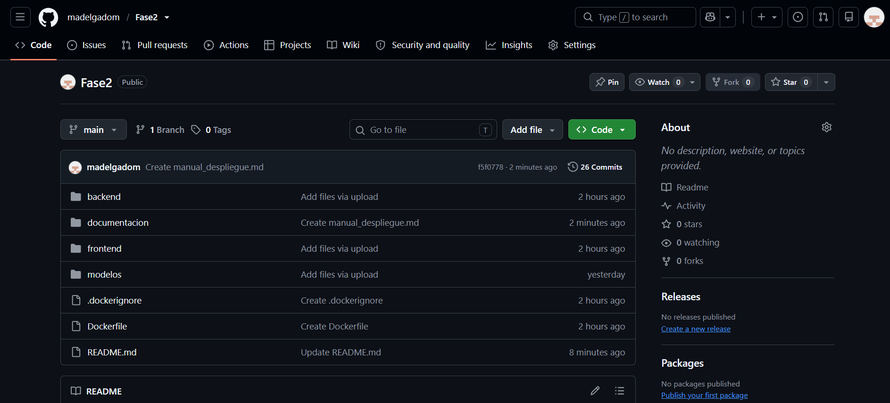

# Manual de despliegue local del Detector Inteligente de SPAM mediante Docker

## 1. Introducción

El despliegue de aplicaciones basadas en Inteligencia Artificial representa una etapa fundamental dentro del ciclo de vida de un proyecto de Machine Learning, ya que permite trasladar un modelo previamente entrenado hacia un entorno donde pueda ser utilizado por otros componentes de software y usuarios finales.

En este proyecto desarrollamos una aplicación web denominada **Detector Inteligente de SPAM**, cuyo propósito es clasificar mensajes de texto como SPAM o NO SPAM mediante un modelo de aprendizaje supervisado basado en el algoritmo Multinomial Naive Bayes.

Para su implementación utilizamos una arquitectura que integra una interfaz web desarrollada con HTML, CSS y JavaScript, un backend construido mediante FastAPI y un modelo de Inteligencia Artificial entrenado con Scikit-learn.

Con el objetivo de facilitar su ejecución y portabilidad, utilizamos Docker como tecnología de contenerización. Esto nos permite empaquetar los componentes de nuestra aplicación dentro de una imagen que puede ejecutarse en diferentes equipos compatibles, manteniendo un entorno de software consistente.

El presente manual documenta los requerimientos técnicos, la estructura del proyecto, el proceso de construcción de la imagen Docker, la ejecución del contenedor y las pruebas realizadas para verificar el funcionamiento de la solución en un entorno local.

## 2. Objetivo del manual

El objetivo de este manual es describir de manera detallada el procedimiento necesario para construir, ejecutar y validar localmente nuestra aplicación de Inteligencia Artificial mediante Docker.

Buscamos proporcionar instrucciones claras y reproducibles que permitan recuperar el código fuente desde GitHub, construir la imagen del contenedor, iniciar el servicio y comprobar la integración entre el frontend, el backend y el modelo de clasificación.

Asimismo, documentamos los mecanismos utilizados para verificar la disponibilidad de la API REST y el funcionamiento del modelo mediante solicitudes HTTP.

## 3. Requerimientos técnicos

Para ejecutar nuestra aplicación es necesario contar con un equipo que tenga acceso a internet y un entorno compatible con Docker.

En nuestro caso, realizamos el procedimiento utilizando una computadora Mac con Docker Desktop instalado.

Los principales requerimientos son:

| Componente | Requerimiento |
|---|---|
| Sistema operativo | macOS, Windows o Linux compatible con Docker |
| Docker | Docker Desktop o motor Docker compatible |
| Git | Cliente Git para clonar el repositorio |
| Navegador | Google Chrome, Safari u otro navegador moderno |
| Conexión a internet | Necesaria para clonar el repositorio y descargar dependencias |
| Python | Versión 3.11 dentro del contenedor |
| Puerto de aplicación | 8080 |
| Repositorio | https://github.com/madelgadom/Fase2 |

Es importante mencionar que **no es necesario instalar Python directamente en la computadora** para ejecutar la aplicación contenerizada, ya que la imagen Docker incorpora el intérprete y las dependencias necesarias.

## 4. Arquitectura de la solución

Nuestra aplicación utiliza una arquitectura web que integra tres componentes principales: frontend, backend y modelo de Inteligencia Artificial.

El frontend representa la interfaz mediante la cual el usuario introduce el mensaje que desea analizar. JavaScript captura el contenido y realiza una solicitud HTTP POST al endpoint `/predecir`.

El backend, desarrollado mediante FastAPI, recibe la solicitud, valida la información y utiliza el vectorizador TF-IDF para transformar el texto en una representación numérica.

Posteriormente, el modelo Multinomial Naive Bayes procesa dicha representación y genera una clasificación.

Finalmente, FastAPI devuelve una respuesta JSON que contiene la categoría identificada y el porcentaje de confianza estimado. JavaScript interpreta esta respuesta y presenta el resultado mediante un cuadro rojo cuando detecta SPAM o verde cuando identifica NO SPAM.

Todos estos componentes se ejecutan dentro de un mismo contenedor Docker.

[Imagen 1. Diagrama de arquitectura de la aplicación: Usuario → Frontend HTML/CSS/JavaScript → API REST FastAPI → Vectorizador TF-IDF → Modelo Naive Bayes → Respuesta JSON → Frontend.]

## 5. Organización del repositorio GitHub

Para administrar el código fuente utilizamos GitHub, una plataforma que permite almacenar, organizar y versionar proyectos de software mediante Git.

Nuestro repositorio se encuentra disponible en:

https://github.com/madelgadom/Fase2

La estructura principal del proyecto es:

```text
Fase2/
├── backend/
│   ├── principal.py
│   └── requirements.txt
├── frontend/
│   ├── index.html
│   ├── estilos.css
│   └── aplicacion.js
├── modelos/
│   ├── modelo_spam.joblib
│   └── vectorizador_tfidf.joblib
├── Dockerfile
├── .dockerignore
└── README.md
```

Esta organización permite separar las responsabilidades de cada componente. La carpeta `backend` contiene la lógica de la API, mientras que `frontend` almacena los elementos visuales de la aplicación.

Por su parte, la carpeta `modelos` contiene los archivos generados durante el entrenamiento, que permiten realizar predicciones sin necesidad de entrenar nuevamente el algoritmo.

Finalmente, el archivo `Dockerfile` establece las instrucciones para construir la imagen, mientras que `.dockerignore` define los archivos que deben excluirse del contexto de construcción.



## 6. Clonación del repositorio

El primer paso para ejecutar nuestra aplicación consiste en obtener una copia local del repositorio.

Para ello, abrimos la Terminal de nuestra computadora y utilizamos el comando:

```bash
git clone https://github.com/madelgadom/Fase2.git
```

Este comando descarga los archivos versionados del proyecto y crea una carpeta denominada `Fase2`.

Posteriormente, accedemos al directorio utilizando:

```bash
cd Fase2
```

Podemos comprobar su contenido mediante:

```bash
ls -la
```

Esto nos permite verificar que contamos con el código fuente, los archivos de configuración y el modelo de Inteligencia Artificial antes de iniciar la construcción de la imagen Docker.

[Imagen 3. Captura de la Terminal mostrando la clonación del repositorio y la verificación de sus archivos mediante ls -la.]

## 7. Configuración del Dockerfile

Docker utiliza un archivo denominado `Dockerfile` para definir las instrucciones necesarias para construir una imagen.

Una imagen Docker representa un paquete de software que contiene la aplicación, sus dependencias y la configuración requerida para su ejecución.

En nuestro proyecto utilizamos el siguiente Dockerfile:

```dockerfile
FROM python:3.11-slim

WORKDIR /aplicacion

COPY backend/requirements.txt ./backend/requirements.txt

RUN pip install --no-cache-dir -r backend/requirements.txt

COPY backend/ ./backend/
COPY frontend/ ./frontend/
COPY modelos/ ./modelos/

ENV PYTHONUNBUFFERED=1

EXPOSE 8080

CMD ["uvicorn", "backend.principal:aplicacion", "--host", "0.0.0.0", "--port", "8080"]
```

En primer lugar, utilizamos `python:3.11-slim` como imagen base, lo que nos proporciona un entorno de Python con una distribución reducida.

Posteriormente, establecemos `/aplicacion` como directorio de trabajo e instalamos las dependencias especificadas en `requirements.txt`.

Después incorporamos las carpetas del backend, frontend y modelo entrenado. Esto permite que todos los componentes necesarios estén disponibles dentro de la imagen.

Finalmente, configuramos Uvicorn para iniciar nuestra aplicación FastAPI en el puerto 8080.

La instrucción `EXPOSE 8080` documenta el puerto utilizado por el servicio, mientras que `CMD` establece el proceso que se ejecutará cuando iniciemos el contenedor.

[Imagen 4. Captura del archivo Dockerfile dentro del repositorio GitHub, mostrando sus instrucciones de construcción.]

## 8. Construcción de la imagen Docker

Una vez que tenemos el repositorio descargado y el Dockerfile configurado, procedemos a construir la imagen Docker.

Para ello, ejecutamos el siguiente comando desde la carpeta principal del proyecto:

```bash
docker build -t detector-spam-ia:1.0 .
```

Utilizamos `docker build` para iniciar el proceso de construcción.

El parámetro `-t` permite asignar un nombre y una etiqueta a la imagen. En nuestro caso, utilizamos `detector-spam-ia` como identificador y `1.0` como versión.

El punto final indica que Docker debe utilizar el directorio actual como contexto de construcción.

Durante este procedimiento, Docker descarga la imagen base, instala las dependencias y copia los archivos necesarios.

Una vez finalizado, verificamos que la imagen se encuentre disponible mediante:

```bash
docker images
```

En nuestra implementación comprobamos que la imagen `detector-spam-ia:1.0` se construyó correctamente.

[Imagen 5. Captura de la Terminal mostrando la finalización exitosa del comando docker build.]

[Imagen 6. Captura de la Terminal ejecutando docker images, donde aparezca la imagen detector-spam-ia con la etiqueta 1.0.]

## 9. Ejecución del contenedor Docker

Después de construir la imagen, iniciamos nuestra aplicación mediante un contenedor.

Un contenedor representa una instancia ejecutable de una imagen Docker. A diferencia de la imagen, que contiene la definición del entorno, el contenedor permite ejecutar los procesos y servicios de nuestra aplicación.

Para iniciar el contenedor utilizamos:

```bash
docker run -d --name detector-spam -p 8080:8080 detector-spam-ia:1.0
```

En este comando, `docker run` crea y ejecuta el contenedor.

El parámetro `-d` permite mantenerlo funcionando en segundo plano, mientras que `--name` establece el identificador `detector-spam`.

Por otra parte, `-p 8080:8080` conecta el puerto 8080 de nuestra computadora con el puerto 8080 del contenedor.

Posteriormente, verificamos su estado mediante:

```bash
docker ps
```

Este comando muestra los contenedores activos, permitiéndonos comprobar que nuestra aplicación continúa ejecutándose.

[Imagen 7. Captura de la Terminal mostrando docker ps, con el contenedor detector-spam en estado Up y el puerto 8080 publicado.]

## 10. Acceso a la aplicación web

Una vez iniciado el contenedor, podemos acceder a nuestra aplicación desde el navegador utilizando la siguiente dirección:

http://localhost:8080/aplicacion

Esta ruta permite visualizar el frontend desarrollado con HTML, CSS y JavaScript.

La interfaz contiene un campo de texto donde el usuario puede introducir un mensaje y un botón denominado **Analizar mensaje**.

Cuando el usuario presiona el botón, JavaScript envía una solicitud a FastAPI, que procesa el contenido utilizando el modelo de Inteligencia Artificial.

Posteriormente, la aplicación presenta el resultado de manera visual.

Si el mensaje se clasifica como SPAM, se muestra un cuadro rojo de advertencia. Si se clasifica como NO SPAM, aparece un cuadro verde.

Adicionalmente, se presenta el porcentaje de confianza estimado por el modelo.

[Imagen 8. Captura de la aplicación web en http://localhost:8080/aplicacion mostrando el formulario para ingresar mensajes.]

[Imagen 9. Captura del frontend mostrando un mensaje clasificado como SPAM dentro del cuadro rojo, junto con el porcentaje de confianza.]

[Imagen 10. Captura del frontend mostrando un mensaje clasificado como NO SPAM dentro del cuadro verde, junto con el porcentaje de confianza.]

## 11. Validación de la API REST mediante Swagger UI

FastAPI proporciona documentación interactiva mediante Swagger UI, una herramienta que permite consultar y probar los endpoints disponibles.

Para acceder a esta documentación utilizamos:

http://127.0.0.1:8080/docs

Dentro de esta interfaz identificamos los siguientes endpoints:

| Endpoint | Método | Función |
|---|---|---|
| `/` | GET | Consultar el estado de la API |
| `/predecir` | POST | Clasificar mensajes como SPAM o NO SPAM |

Para validar el endpoint de clasificación, seleccionamos `POST /predecir`, presionamos **Try it out** e introducimos una solicitud JSON.

```json
{
  "mensaje": "Congratulations! You won $50,000! Claim your free prize now!"
}
```

Posteriormente, presionamos **Execute** para enviar la solicitud al backend.

Durante nuestras pruebas obtuvimos una respuesta HTTP 200 y una clasificación SPAM con una confianza estimada del 97.24 %.

Esto demuestra que la API recibe correctamente la información, utiliza el modelo entrenado y devuelve una respuesta estructurada.

[Imagen 11. Captura de Swagger UI mostrando los endpoints GET / y POST /predecir.]

[Imagen 12. Captura de Swagger UI mostrando la solicitud POST /predecir, el código HTTP 200 y la respuesta JSON con la clasificación SPAM y confianza de 97.24 %.]

## 12. Validación funcional y casos extremos

Además de verificar el funcionamiento general de la aplicación, realizamos pruebas orientadas a identificar su comportamiento ante diferentes condiciones de entrada.

Estas pruebas son importantes porque permiten comprobar tanto la capacidad predictiva del modelo como los mecanismos de validación implementados en el backend.

Los resultados obtenidos fueron los siguientes:

| Caso de prueba | Código HTTP | Resultado |
|---|---|---|
| Mensaje SPAM | 200 | SPAM — 96.70 % |
| Mensaje NO SPAM | 200 | NO SPAM — 98.40 % |
| Mensaje vacío | 422 | Entrada rechazada |
| Mensaje superior a 5,000 caracteres | 422 | Entrada rechazada |
| Mensaje con caracteres especiales | 200 | SPAM — 94.73 % |
| Mensaje ambiguo | 200 | NO SPAM — 96.06 % |

Los resultados demuestran que nuestra API procesa correctamente las solicitudes válidas y rechaza entradas que incumplen las restricciones definidas.

En particular, las pruebas con mensajes vacíos y textos superiores a 5,000 caracteres devolvieron el código HTTP 422, correspondiente a errores de validación.

Asimismo, comprobamos que el modelo puede procesar mensajes con caracteres especiales y clasificar mensajes ambiguos, aunque esto no garantiza que todas las predicciones sean correctas.

[Imagen 13. Evidencia de Swagger UI mostrando el error HTTP 422 al enviar un mensaje vacío.]

[Imagen 14. Evidencia de Swagger UI mostrando el error HTTP 422 al superar el límite de 5,000 caracteres.]

## 13. Comandos para administrar el contenedor

Docker proporciona diferentes comandos que permiten consultar, detener, iniciar y eliminar contenedores.

Para consultar los contenedores activos utilizamos:

```bash
docker ps
```

Para consultar los registros de ejecución:

```bash
docker logs detector-spam
```

Para detener el contenedor:

```bash
docker stop detector-spam
```

Para iniciar nuevamente un contenedor previamente detenido:

```bash
docker start detector-spam
```

Para eliminar el contenedor, primero debemos detenerlo y posteriormente ejecutar:

```bash
docker rm detector-spam
```

Es importante mencionar que eliminar un contenedor no elimina automáticamente la imagen Docker utilizada para crearlo.

Estos comandos facilitan la administración del entorno local y permiten reproducir las pruebas cuando sea necesario.

## 14. Consideraciones técnicas y limitaciones

Aunque nuestra aplicación se ejecuta correctamente dentro de Docker, es importante reconocer algunas limitaciones.

En primer lugar, el modelo fue entrenado principalmente con mensajes en inglés, por lo que su capacidad para clasificar mensajes en español u otros idiomas no ha sido evaluada de manera suficiente.

Asimismo, durante la evaluación del modelo identificamos una sensibilidad del 80.54 % para la categoría SPAM, lo que indica que algunos mensajes no deseados pueden clasificarse incorrectamente como legítimos.

Otra consideración corresponde al porcentaje de confianza mostrado en la interfaz. Este valor representa una probabilidad estimada por el clasificador, pero no constituye una garantía de que la predicción sea correcta.

Finalmente, el despliegue realizado corresponde a un entorno local. Aunque Docker facilita la portabilidad de nuestra solución, no hemos implementado mecanismos adicionales de autenticación, monitoreo productivo o escalabilidad.

Por esta razón, consideramos que la aplicación cumple con los objetivos de integración y contenerización académica, pero requeriría controles adicionales antes de utilizarse en un entorno productivo.

## 15. Conclusiones

El desarrollo y despliegue local del Detector Inteligente de SPAM permitió integrar diferentes tecnologías dentro de una solución funcional basada en Inteligencia Artificial.

Mediante Docker logramos construir una imagen que incorpora el frontend, el backend, las dependencias de Python y el modelo Naive Bayes previamente entrenado. Esto nos permitió ejecutar la aplicación en un entorno consistente, sin depender de una instalación manual de las librerías utilizadas durante el desarrollo.

Asimismo, comprobamos la comunicación entre los componentes mediante solicitudes HTTP y validamos el funcionamiento de la API utilizando Swagger UI. Las pruebas realizadas demostraron que el sistema puede recibir mensajes, procesarlos mediante TF-IDF y devolver clasificaciones acompañadas de un porcentaje de confianza estimado.

La evaluación de casos extremos también permitió comprobar que el backend rechaza entradas inválidas y mantiene su funcionamiento ante diferentes tipos de contenido.

En conjunto, los resultados obtenidos demuestran que la contenerización facilita la portabilidad, organización y reproducibilidad de aplicaciones basadas en Machine Learning. Además, la integración mediante API permite separar las responsabilidades de cada componente y establecer una arquitectura que puede ampliarse en futuros desarrollos.

De esta manera, consideramos que nuestro proyecto cumple con los objetivos de despliegue local, integración técnica y validación funcional establecidos para esta fase académica.
